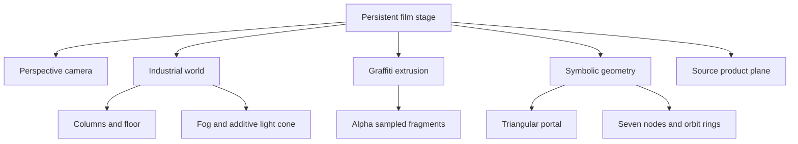

# CAISIK — cinematic scene plan

One native scroll sequence, one persistent stage, six camera keyframes. The art direction preserves the existing graffiti artwork, obsidian/graphite, aged gold and oxide accents. No wheel interception or forced scroll velocity.

| Chapter | Camera / composition | Idea | Visitor action |
|---|---|---|---|
| THE PORTAL | Slow approach to extruded original graffiti; nested triangular portal | Cross from street to symbol | Enter the city or skip directly to products |
| THE CITY | Camera moves left and forward through industrial columns | Clothing carries an idea through everyday life | Explore the shadow chapter |
| THE DISSOLUTION | Off-axis close approach; emblem alpha sampled into controlled fragments | Question the inherited image | Enter the seven principles |
| THE SEVEN PRINCIPLES | Pull back to seven geometric nodes | Learn a historical philosophical vocabulary | Select one of seven lessons |
| THE FORGE | Reframe the actual OMERTA source preview | Translate a symbol into a garment | Open the real product or the conceptual 3D exhibit |
| THE DROP | Wider final composition, product retained | Choose consciously | Browse the verified catalog or original store |

The reference YouTube page loaded, but its player remained at 0:00 with readyState 0 and no playable frames. No camera, lighting or pacing analysis of that video is claimed. The scene plan above is an original implementation based on the written brief.

## Scene graph

`src/cinematic/scene-config.js` owns camera targets, emblem positions and adaptive quality. `scene.js` owns rendering; `index.js` owns scroll, accessibility modes, lifecycle and local performance readings. These are reusable independently of the existing catalog and lesson renderers.

The light cone approximates atmospheric illumination; it is not ray-marched volumetric lighting. The product plane uses an authentic source image and is not a manufacturing-accurate garment model. The separate existing forge remains an explicitly labelled conceptual sculpture, with orbit, zoom, light and artwork-layer controls where WebGL is available.
